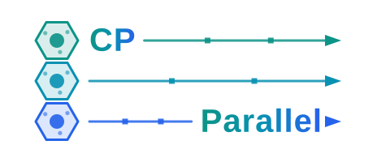

# CellProfiler (CP) Parallel



> ⚙️ Speed up your CellProfiler analyses through the power of parallelization!

CP Parallel is a small, installable Python package that runs [CellProfiler](https://cellprofiler.org/) headless on multiple plates (or wells) at once.
CellProfiler pipelines typically include, but are not limited to:

1. Maximum projections of multiple z-slices per FOV
2. Illumination correction
3. Segmentation and feature extraction

CellProfiler can be run either with the GUI or through headless mode via the terminal.
We prefer to use the headless mode option since it is most reproducible.
One of the major downsides of headless mode is that you can not run multiple plates in parallel out of the box.

CP Parallel solves this by taking a dictionary describing each plate (or well), running `cellprofiler` for each one in a process pool, and writing a log file per run.

This package replaces the `utils/cp_parallel.py` (or `cp_utils.py`) file that has historically been copy-pasted into each Way Science repository and patched independently over time.
Installing it as a dependency means every repo shares one implementation and gets bug fixes/new features without manually re-copying a script.

## Features

- **One plate or many** — the same function handles a single-plate dictionary and a many-plate dictionary; parallelism is just "how many entries did you pass in".
- **Plate-level or well-level grouping** (`group_level="plate"` / `"well"`) — run per-well with CellProfiler's `-g Well=...` grouping flag, with per-plate log subdirectories.
- **Images directory or LoadData CSV** — each entry uses either `path_to_images` (`-i`) or `path_to_loaddata` (`--data-file`).
- **Batch processing** — restrict a run to an image-set range with `first_image_set` / `last_image_set` (`-f`/`-l`), and cap concurrency independent of batch size with `max_workers`, so a large run (e.g. a timelapse dataset, or any big LoadData CSV) can be split into batches across multiple calls without clobbering each other's logs.
- **HPC compatible** — CPU-count detection respects job/cgroup CPU affinity (e.g. a SLURM allocation) rather than the full host's core count, and `run_with_apptainer` runs CellProfiler inside an Apptainer/Singularity container (whichever is found on `PATH`).
- **CellProfiler plugins** — a plugins directory can be set for all plates (`plugins_dir`) or overridden per plate (`plugins_directory` key).

## Installation

**Prerequisite:** `cp_parallel` does not install CellProfiler, and has no runtime dependencies of its own.
It works by shelling out to a `cellprofiler` command that must already be on `PATH`.
CellProfiler itself pulls in wxPython, a Java bridge, and a long chain of pinned scientific dependencies that are fragile to install via `pip`/`uv`, so it's installed separately — typically via `conda`/`mamba` ([CellProfiler's own installation docs](https://cellprofiler.org/releases)), or made available through an Apptainer/Singularity container on HPC (see [`run_with_apptainer`](#running-on-an-hpc-cluster-via-apptainersingularity) below).
Install `cp_parallel` into that same environment (or alongside that container) with any of the methods below.

Install directly from GitHub with `pip` (works inside a conda/mamba environment too):

```bash
pip install git+https://github.com/WayScience/CP_Parallel.git
```

To pin to a specific released version instead of tracking `main`, append a tag:

```bash
pip install git+https://github.com/WayScience/CP_Parallel.git@v0.1.0
```

Or add it to a `pyproject.toml` / `environment.yml`'s pip dependencies:

```toml
dependencies = [
    "cp_parallel @ git+https://github.com/WayScience/CP_Parallel.git",
]
```

If your repo is [`uv`](https://docs.astral.sh/uv/)-managed, add it the same way with `uv add`:

```bash
uv add git+https://github.com/WayScience/CP_Parallel.git
```

## Usage

> **Tutorial notebook:** [examples/cp_parallel_tutorial.ipynb](examples/cp_parallel_tutorial.ipynb) walks through every example below (and runs end-to-end on its own, with no CellProfiler install required, via a stand-in for the `cellprofiler` executable) if you'd rather follow along interactively.

### A single plate

```python
import cp_parallel

plate_info_dictionary = {
    "Plate1": {
        "path_to_pipeline": "pipelines/analysis.cppipe",
        "path_to_images": "data/Plate1/images",
        "path_to_output": "outputs/Plate1",
    },
}

cp_parallel.run_parallel(
    plate_info_dictionary=plate_info_dictionary,
    run_name="whole_image_qc",
)
```

### Multiple plates, with a LoadData CSV instead of a raw image directory

```python
plate_info_dictionary = {
    "Plate1": {
        "path_to_pipeline": "pipelines/analysis.cppipe",
        "path_to_loaddata": "load_data/Plate1_load_data.csv",
        "path_to_output": "outputs/Plate1",
    },
    "Plate2": {
        "path_to_pipeline": "pipelines/analysis.cppipe",
        "path_to_loaddata": "load_data/Plate2_load_data.csv",
        "path_to_output": "outputs/Plate2",
    },
}

cp_parallel.run_parallel(
    plate_info_dictionary=plate_info_dictionary,
    run_name="feature_extraction",
)
```

### Well-level processing

Each entry's key becomes the `-g Well=...` value, and a `plate_name` is required so log files can be grouped per plate:

```python
plate_info_dictionary = {
    "A01": {
        "plate_name": "Plate1",
        "path_to_pipeline": "pipelines/analysis.cppipe",
        "path_to_images": "data/Plate1/images",
        "path_to_output": "outputs/Plate1",
    },
    "A02": {
        "plate_name": "Plate1",
        "path_to_pipeline": "pipelines/analysis.cppipe",
        "path_to_images": "data/Plate1/images",
        "path_to_output": "outputs/Plate1",
    },
}

cp_parallel.run_parallel(
    plate_info_dictionary=plate_info_dictionary,
    run_name="well_qc",
    group_level="well",
)
```

### Batch processing by image-set range

Split a large run into batches and cap concurrency with `max_workers` (independent of how many batches you process at once), using `first_image_set`/`last_image_set` to select an image-set range for each batch.
This is useful for a timelapse dataset, checkpointing progress on a long run, or managing memory on a large LoadData CSV:

```python
for batch_index, (first, last) in enumerate([(1, 100), (101, 200)]):
    cp_parallel.run_parallel(
        plate_info_dictionary={
            f"batch_{batch_index}": {
                "path_to_pipeline": "pipelines/analysis.cppipe",
                "path_to_loaddata": "load_data/load_data.csv",
                "path_to_output": "outputs/batch_run",
                "first_image_set": first,
                "last_image_set": last,
            }
        },
        run_name="batch_analysis",
        max_workers=4,
    )
```

### Running on an HPC cluster via Apptainer/Singularity

```python
cp_parallel.run_parallel(
    plate_info_dictionary=plate_info_dictionary,
    run_name="feature_extraction",
    run_with_apptainer="/path/to/cellprofiler.sif",
    max_workers=16,  # match your job's allocated CPUs
)
```

`run_with_apptainer` wraps each command as `apptainer exec <image> cellprofiler ...` (or `singularity exec` if that's what's on `PATH` instead).
Pass `max_workers=-1` (or `max_workers="all"`) to use every CPU available to the job.
`max_workers` is validated against the CPUs available to the *job* (via `os.sched_getaffinity` where supported), not the full host, so it plays well with SLURM/cgroup allocations.

### CellProfiler plugins

```python
cp_parallel.run_parallel(
    plate_info_dictionary=plate_info_dictionary,
    run_name="analysis",
    plugins_dir="/path/to/cellprofiler-plugins",
)
```

Set `plugins_directory` on an individual plate's dict instead of (or to override) `plugins_dir` if different plates need different plugin directories.

## `plate_info_dictionary` reference

Each key is a plate name (or well name, when `group_level="well"`).
Each value is a dict with:

| Key | Required | Description |
| --- | --- | --- |
| `path_to_pipeline` | Yes | Path to the `.cppipe` pipeline file. |
| `path_to_output` | Yes | Output directory (created automatically). |
| `path_to_images` | One of this or `path_to_loaddata` | Directory of images (`-i`). |
| `path_to_loaddata` | One of this or `path_to_images` | LoadData CSV (`--data-file`). |
| `plate_name` | Only when `group_level="well"` | Parent plate name, used to group log files. |
| `plugins_directory` | No | Per-plate override of `plugins_dir`. |
| `first_image_set` / `last_image_set` | No | Restrict the run to an image-set range (`-f`/`-l`). |

## API

- `run_parallel(plate_info_dictionary, run_name, group_level="plate", max_workers=None, log_dir="./logs", plugins_dir=None, run_with_apptainer=None, conserve_memory=False)` — runs CellProfiler for every entry in parallel and returns the list of `subprocess.CompletedProcess` results. `max_workers` accepts a positive int, `-1`/`"all"` (use every available CPU), or `None` (one worker per entry, capped to available CPUs).
- `results_to_log(results, log_dir, run_name, jobs=None, group_level="plate")` — writes one log file per result; called automatically by `run_parallel`.
- `MaxWorkerError` — raised when `max_workers` is explicitly set higher than the CPUs available to the process.
- `PlateInfoError` — raised when a `plate_info_dictionary` entry is missing required keys or combines `path_to_images`/`path_to_loaddata` incorrectly.

## Migrating a repo from a copy-pasted `cp_parallel.py`/`cp_utils.py`

1. Delete the repo's local `utils/cp_parallel.py` (or `cp_utils.py`) and its `exceptions.py`, if it isn't shared with other utilities.
2. Add this package as a dependency (see [Installation](#installation)) and install it into the repo's environment.
3. Replace `import cp_parallel` / `from utils import cp_parallel` style imports with `import cp_parallel` (the installed package name is unchanged).
4. If the repo used `path_to_loaddata`/`path_to_images` keys already, no dictionary changes are needed.
   If it used a differently-named key (e.g. `data_file`), rename it to `path_to_loaddata`.
5. Run the repo's existing CellProfiler step once to confirm log files land where expected, then remove the deleted file from version control.

## Development

This project uses [`uv`](https://docs.astral.sh/uv/) to manage its environment and dependencies (`uv.lock` pins them for reproducible installs).
[Install `uv`](https://docs.astral.sh/uv/getting-started/installation/), then:

```bash
uv sync --group dev
uv run pytest --cov=cp_parallel
```

`uv sync` creates a `.venv` with the package installed in editable mode plus the `dev` dependency group (`pytest`, `pytest-cov`, `ruff`, `pre-commit`); `uv run` executes a command inside it without needing to activate it manually.
If you'd rather activate the environment yourself, `source .venv/bin/activate` works as usual afterward.

Tests never invoke a real `cellprofiler`/`apptainer` binary: `subprocess.run` is mocked, and `ProcessPoolExecutor` is swapped for `ThreadPoolExecutor` so the mocks apply inside "worker" threads.

### Linting

[`ruff`](https://docs.astral.sh/ruff/) handles both linting and formatting:

```bash
uv run ruff check . --fix
uv run ruff format .
```

[`pre-commit`](https://pre-commit.com/) runs the same `ruff` checks (plus a few basic hygiene hooks: trailing whitespace, end-of-file newlines, line endings, large-file and merge-conflict checks) automatically on each commit.
Install the git hook once per clone:

```bash
uv run pre-commit install
```

Or run it on demand against the whole repo without installing the hook:

```bash
uv run pre-commit run --all-files
```

CI runs both `pre-commit` and `pytest` on every push and pull request.
